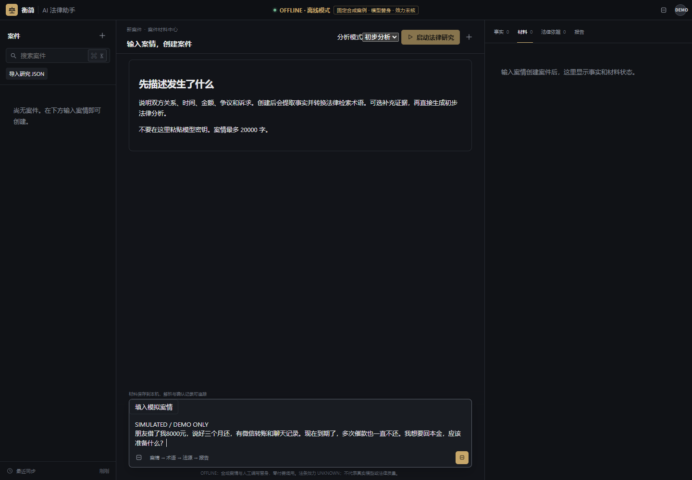
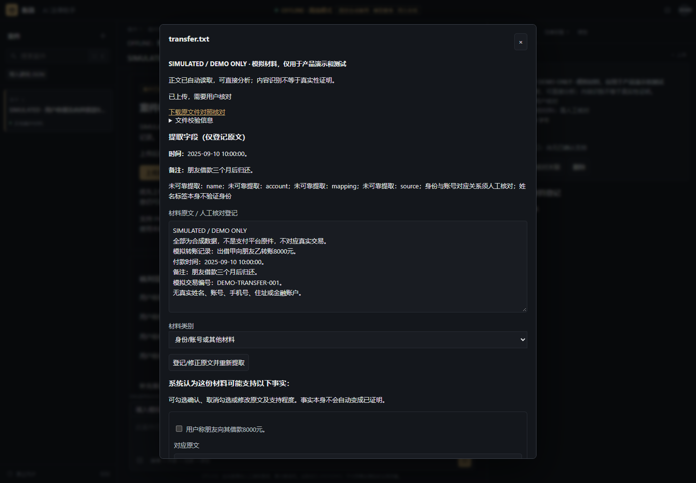
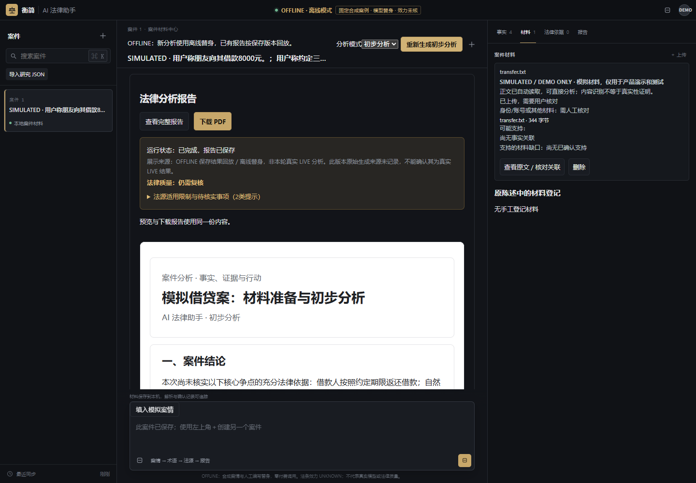
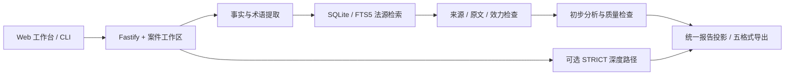

# Chinese · AI 法律助手

作者：[nzzhi](https://github.com/nzzhi) · AI 产品经理作品集

**从一段案情，到有事实分层、依据状态和行动清单的初步分析。**

面向普通用户的本地法律助手原型，也是一个 AI 产品经理作品集：展示如何把模型输出接入可检查、可保存、可失败恢复的产品流程。重点场景是民事纠纷的信息整理；当前不是面向公众运营的法律服务。

> **Demo 为离线合成演示。模型回答使用人工编写的固定替身，法律质量与法源效力尚未全面验证。** 工程流程可运行不等于法律结论可靠。



## 产品问题与取舍

用户会描述经历，却未必知道哪些是事实、证据、法律问题和待确认项。一次流畅的回答也不能说明引用准确、现行有效或适用于本案。

本产品先交付可读的初步分析，允许用户核对材料与缺口；需要更重验证时保留 STRICT 深度研究路径。界面将来源状态、运行状态和法律质量分开，依据不足时保留缺口，不靠反复调用模型制造“成功”。

## 三分钟运行 Demo

需要 **Node.js 24+** 与 npm。首次安装需联网，Demo 运行不需要 Key、不加载 `.env`，并启用外网阻断：

```powershell
npm ci --ignore-scripts --no-audit --no-fund
npm run demo
```

打开 **http://127.0.0.1:3211**：

1. 点击“填入模拟案情”，再点击“创建案件”。
2. 查看提取的事实和未知项；可上传 `demo/materials/transfer.txt`、`chat.txt`，打开原文核对。
3. 点击“生成初步法律分析”，查看法源限制、材料准备与行动建议。
4. 预览并下载 PDF，或下载 JSON/HTML/Markdown/DOCX；刷新后查看保存版本。

停止：终端按 Ctrl+C。默认运行数据在 `.local/portfolio-demo/`，已被忽略；可设置 `DEMO_PORT` 和 `DEMO_WORKSPACE_ROOT`。不要上传真实案件或身份证明来演示。

**Demo 使用人工编写的固定模型替身，仅支持按钮填入的合成借贷样例。** 事实处理、上传读取、本地检索、核验、存储与导出执行实际产品代码；替身回答不是模型能力、法律准确率或真实模型速度的证据。输入其他案情会明确拒绝，不套用借贷结果。Demo 不开放 STRICT 执行，也不自动转入真实模型。





## 核心功能与状态

| 能力 | 本副本实际保留 | 边界 |
| --- | --- | --- |
| 案情理解 | PRELIMINARY 合并事实与检索术语；结构及原文关联校验 | 默认 Demo 为固定替身；真实模型接入代码保留，本轮无付费调用 |
| 材料读取 | TXT/MD、文字 PDF；Windows 中文图片 OCR；原文与事实关联 | OCR 依赖本机中文引擎；扫描 PDF 暂需登记文字；读取不证明真实性 |
| 检索与核验 | SQLite/FTS5、原文/哈希/来源/效力门槛、预算内公开参考补查代码 | Demo 只带两条法律历史摘录，效力为 UNKNOWN；不附原完整数据库，不自动更新 |
| 报告 | 工作台预览及五格式导出，历史版本与刷新读回 | 法律质量可能需要复核或被阻断；不能承诺案件结论正确 |
| 深度研究 | STRICT 规则结构、独立语义检查及适用性门槛实现保留 | 不在固定替身 Demo 中执行；本轮没有完成真实新案验收 |
| 准备提纲 | 项目自行编写的材料准备结构 | 已排除旧法院网页全文；当前提纲不是法院官方诉状模板 |

真实模型模式：复制 `.env.example` 为 `.env` 并自行配置 Provider/Key/模型后，使用 `npm run dev` 或 `npm start`。默认绑定本机 3210 端口。必要输入会发送至配置的模型服务并可能计费；法源库需另行合法准备，空库/UNKNOWN 会产生缺口。不要把本地原型直接暴露到公网。

## 架构



技术栈：TypeScript、Node.js 内置 SQLite、Fastify、Zod、原生 HTML/CSS/JavaScript、OpenAI-compatible 模型接口、PDFKit、docx、PDF.js。复用本地关键词检索，没有为展示新增向量数据库或通用 Agent 框架。

入口：[工作台 API](src/workbench/server.ts)、[初步流程](src/assistant/preliminaryWorkflow.ts)、[模型客户端](src/llm/modelClient.ts)、[本地法源](src/authority/)、[报告](src/report/)。外部输入使用运行时校验；请求、查询、核验与执行时间有边界，失败保存已有材料。

## 我的职责与 AI 协作

- **产品构思**：提出面向普通用户的法律信息整理场景，确定产品希望解决的问题及能力边界。
- **需求设计**：设计案情输入、事实与材料核对、法源展示、报告导出等流程，明确范围和验收要求。
- **AI 辅助开发**：使用 Codex 辅助代码分析、实现、调试与文档整理，负责提出需求、审阅结果和确认取舍；大量代码由 AI 辅助完成，不宣称全部代码独立手写。
- **测试验收**：依据实际运行结果检查功能与报告，区分离线替身、真实模型、工程成功与法律质量，不把局部通过表述为整体可靠。
- **迭代**：根据体验与失败记录调整优先级，推动可读性、可追溯性和失败处理改善；未完成能力继续标明。

公开署名仅使用 GitHub 用户名 `nzzhi`，不展示真实姓名、个人邮箱或联系方式。没有可公开证明的用户规模、留存、收入、法律准确率或团队管理数据，不编造增长业绩。

## 验证与已知局限

```powershell
npm test
npm run typecheck
npm run build
```

本副本的实际验证与范围见 [验证说明](docs/VALIDATION.md)。公开测试仅含合成数据，不包含研发仓库的历史模型原响应；因此不继承完整研发测试集的数量或覆盖声明。

- 法律适用、范围条件及证据推论仍可能错误；当前不提供确定法律意见、胜诉预测或律师替代承诺。
- 小样本 Demo 不证明泛化；两条摘录不能代表完整法源库，UNKNOWN 不会被升级为已核验。
- 缺少公众服务所需的身份认证、租户隔离、存储加密和完整数据生命周期治理；仅限本地可信环境。
- OCR 当前依赖 Windows；任意新案的真实模型质量、生产恢复能力与并行/缓存收益，本轮未验证。
- 多轮追问、通用法律文书生成和模拟法庭不作为已完成功能展示。

## 许可与公开范围

暂不为项目源码添加开源许可证，保留后续选择权；当前为作品展示副本，见 [源码权利说明](RIGHTS.md)。不要将“GitHub 可见”理解为自动获得 MIT 许可。第三方字体及依赖继续适用各自原有许可。

PDF 默认使用随附的 **Noto Sans CJK SC（SIL OFL 1.1）**，不打包系统黑体或旧的嵌入字体 PDF。法源仅保留法律正文摘录，不附官网 HTML、图像、编辑内容或私有数据库。全部案情、材料与截图为本副本合成流程产生，见 [第三方及素材声明](THIRD_PARTY_NOTICES.md)、[依赖清单](docs/DEPENDENCIES.md)和 [公开文件清单](PUBLIC_FILES.md)。
